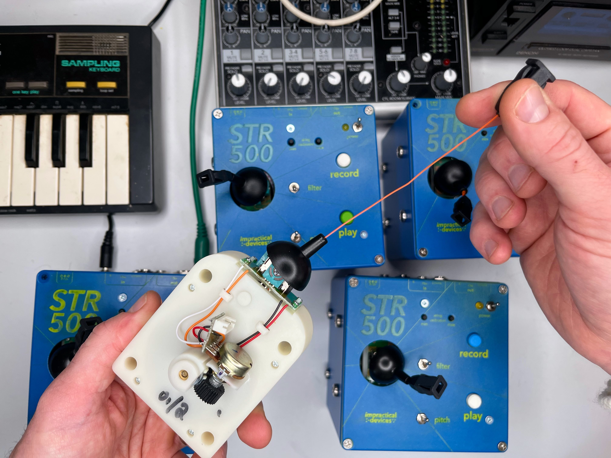
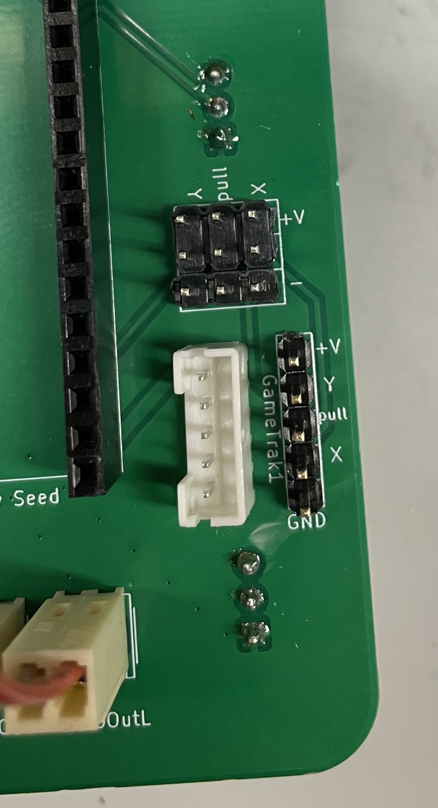
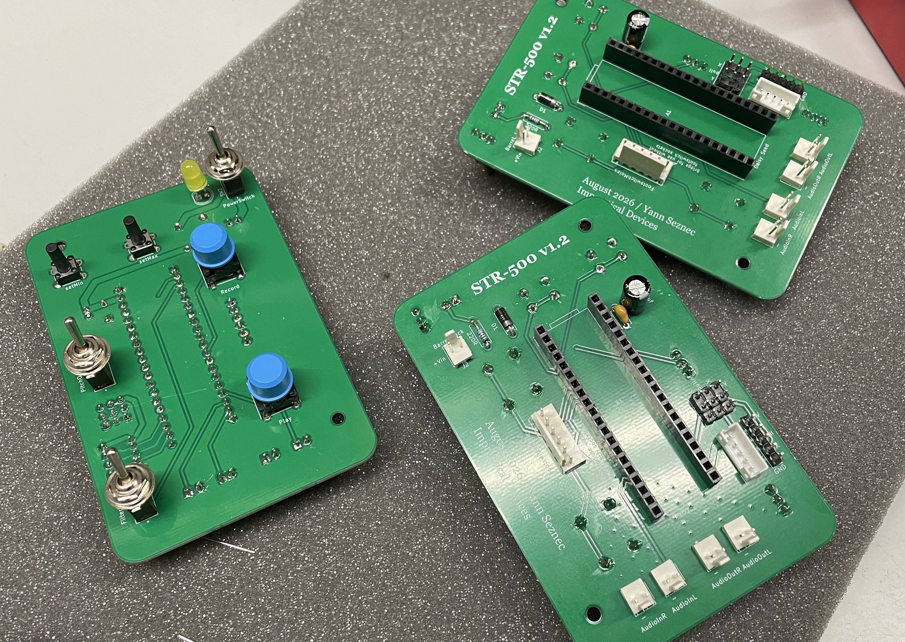
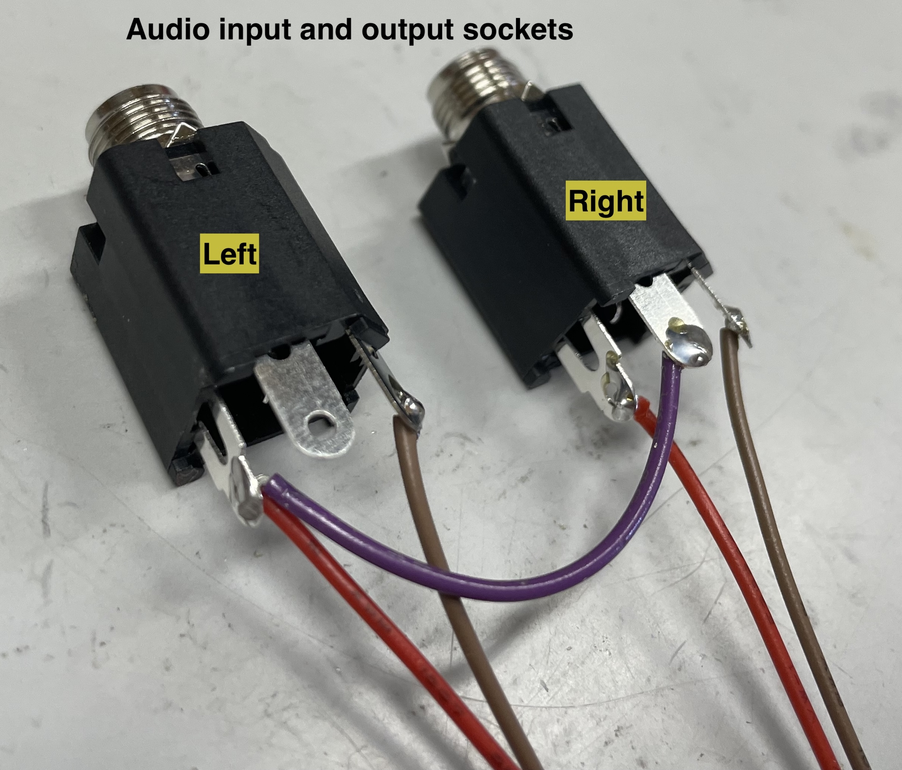

# STR500 DIY Kit (v1.2)

Some information for people who have bought a STR-500 DIY Kit. There is a lot of overlap here with the [PCB_build_instructions](PCB_instructions/PCB_build_instructions.md) and [Build Notes](Build_Notes.md), but hopefully this is useful too. 

## What's in the box
An STR-500 DIY Kit comes with the following:
- PCB with all components soldered
- Button covers of all the buttons
- Little jumper connectors on the footswitch Molex header
- A separate cable with sockets connected to a 6-pin connector, for use on the footswitch Molex header if you want
- Hardware for attaching to an enclosure: 2 standoffs, 2 little screws, threaded nuts for the toggle switches and sockets
- Audio sockets with Molex connectors
- Power socket with Molex connector
- 5 pin JST PH cable for use with a second generation Gametrak
- Power supply (if you ordered one)
- Daisy Seed microcontroller (if you ordered one)

## Gametrak
The STR-500 is designed with a Gametrak string controller in mind, though you can connect other analog inputs too. See this video for info on how to hack Gametraks: https://youtu.be/GELGBzM0ZOE 

For my builds of the STR-500 I use a second generation Gametrak, which is easiest to disassemble and reassemble into a new container.

When you disassemble a second generation Gametrak you will get two string cartridges. Each cartridge has wires connected to the string and joystick with a 5 pin JST PH (2mm spacing) connector. If you have one of these strings, you can use the included 5-pin JST PH cable to connect to the PCB.

If you are planning on using a first generation Gametrak, or some other analog input, you can use the extra 2.54mm pin sockets on the PCB. This video shows how to connect a 1st generation Gametrak to these pins: https://youtu.be/SXaPP8HPXNw

## Footswitch 
When I send you the Kit I will attach two little jumper pins on the Footswitch header on the PCB. This enable the STR-500 play and record buttons to work without the footswitch sockets attached, which makes it easier to get up and running. These jumper pins must stay on the header pins unless you replace them with the sockets. More information about this is available on the [Build Notes](Build_Notes.md). 

To-do: a tutorial on making a footswitch or other external control

## Button caps
The buttons on the board use replaceable caps. You can replace these if you like, to suit the enclosure you make. Just carefully pop them off. The larger buttons are made by MEC and they have a variety of different shape and sized caps, look for caps that fit their 5G range. 

I have included rather tall button caps on the smaller buttons. Various other caps are available, though it can be tricky to be certain they will fit. The model number of the button is TL1105, just be sure you find a cap that fits the square shape. 

*note: some earlier versions I made used different buttons, without replaceable covers, for the calibration*

## Hardware
I have included the same hardware that I use to make my instruments. Namely, two 9mm M3 standoffs and little M3 screws. I use these to attach the PCB to the lid of my enclosures, along with the three nuts on the toggle switches. This keeps everything nice and solid under the lid. These are all of course optional, you can figure out any other attachment method you like to fit whatever enclosure you end up using. 

## Enclosure design
If you want to copy, or borrow elements from, my enclosure design, check the [STR500_v1.2_enclosure](../STR500_v1.2_enclosure/) folder. There you will find the vector files for the designs, the PCB, and the files I use for laser etching the powder coated lids of the enclosures before drilling. 

I use pre-powder coated Hammond 1590VBK enclosures. They are also available in grey (1590VGY) or uncoated (1590V).

Alternatively, you can just design your own enclosure around whatever string or analog input system you use. Please consider sharing any 3D printing models or drill files or anything, so I can include them in this repository.

## Power
The power socket is a standard 2.1mm pin, center positive. The board can take between 5-12v. Make sure your power supply has the correct polarity (don't use a guitar pedal power supply).

## Audio Inputs and Outputs (these are identical)
I usually ship the kit with the audio sockets plugged in. The pins on the board are labeled to show input, output, and left and right. You will notice that the sockets are in two connected pairs, one for input and one for output.

For both pairs, the socket that has wires soldered to only two pins is the **left** channel. The socket that has wires soldered to all three pins is the **right** channel. 

Audio input and output is unbalanced, line-level. You'll need a mixer or something to manage your input and output signal. 

## Daisy Seed & Pure Data
If you ordered your kit with a Daisy Seed, the board will already have the STR-500 code flashed onto it. If you have your own seed, or want to change anything, see the [STR500_code folder](../STR500_code) for the code and some information on how to load it onto the Seed.

## Check the KiCAD
If you are comfortable with KiCAD you can check the circuit and layout if you aren't sure, the [entire project](../kicad) is in this repo.

