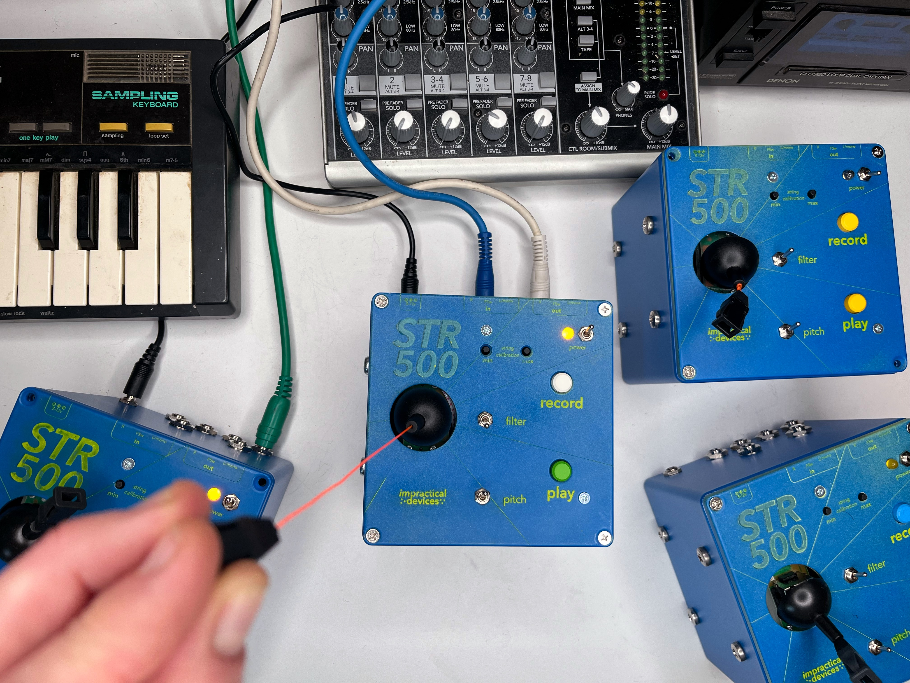

## STR-500

This is all of the code and build info for the STR-500 gestural granular synthesizer. Watch this video for some background on the project and to see the instrument in action: https://youtu.be/luxsUPbPhyk 

The STR-500 is a granular synthesizer built for the Daisy Seed which uses a salvaged Gametrak string controller to playback a recorded sample. 

Here you will find a Pure Data system for running on the Daisy Seed, a KiCad project with the schematic and PCB design for the instrument, and a folder of information about the physical build including drill outlines and laser cutting files for the enclosure. Current working version is called v1.2. 

The project website can be found 

This project is produced by , which is mainly the work of . Get in touch if you have any questions: yann@yannseznec.com.