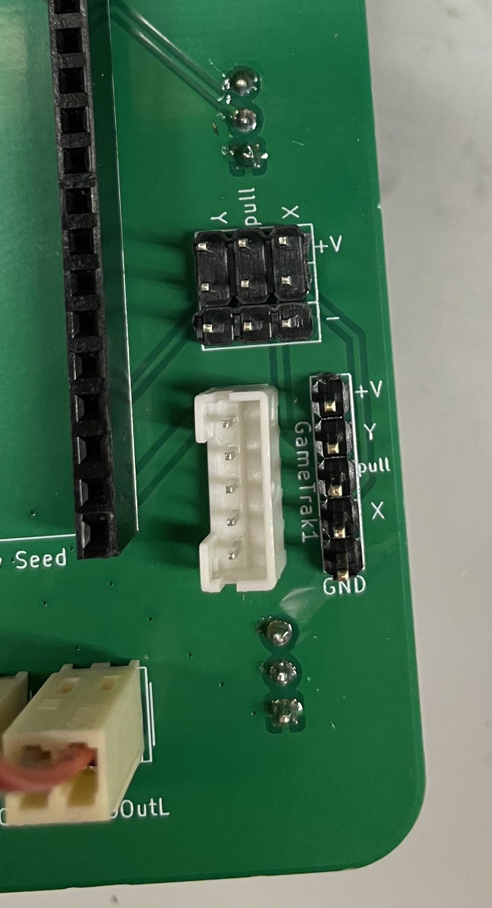
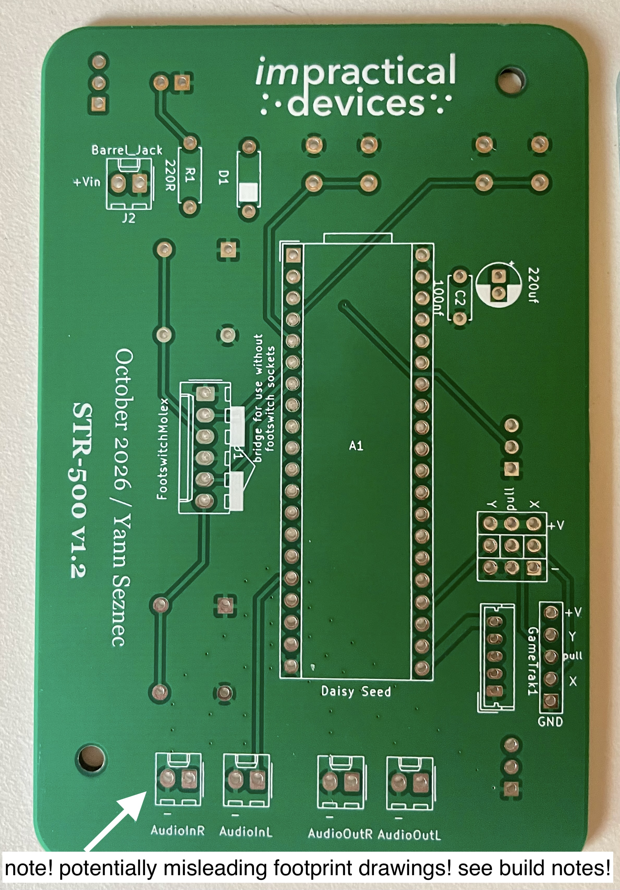
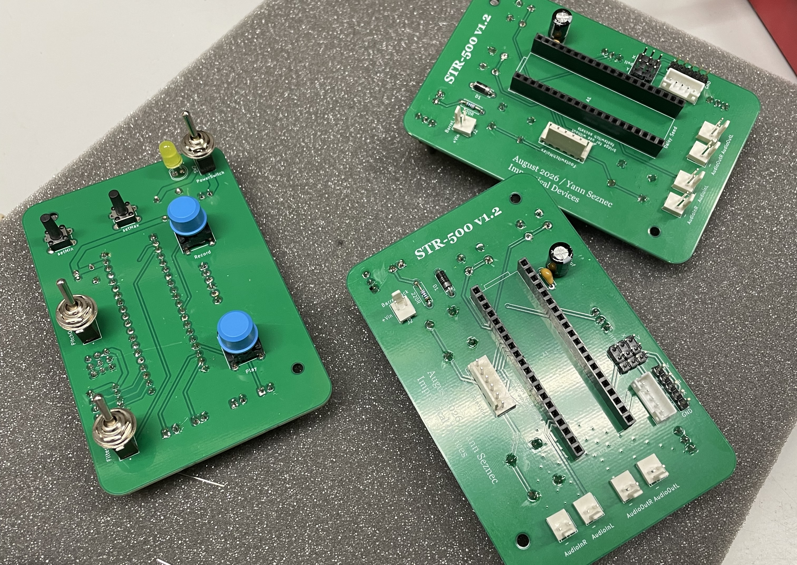
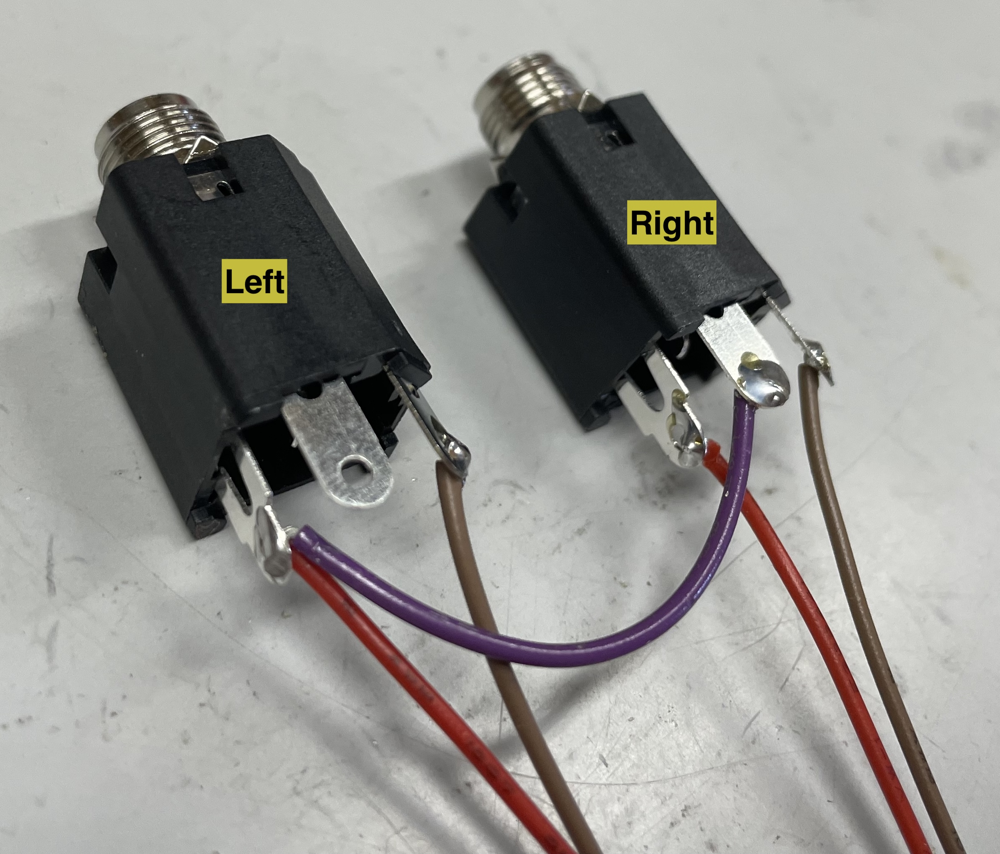
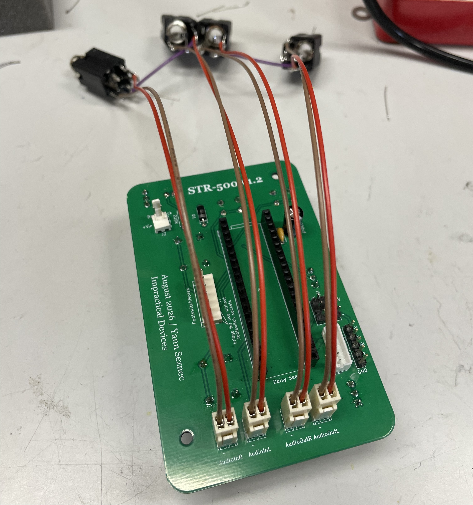
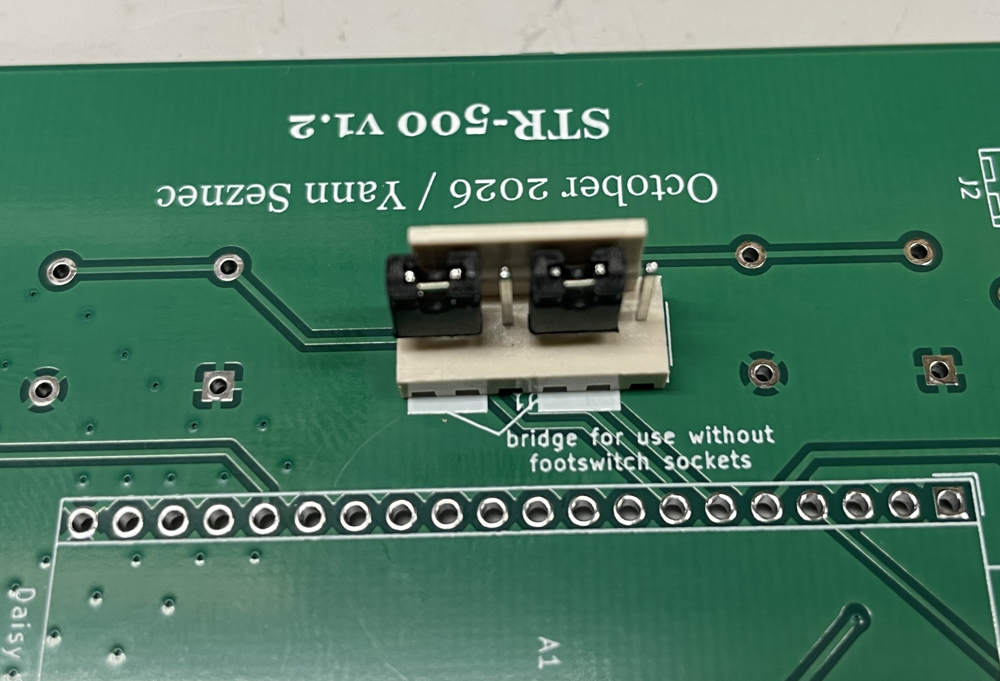
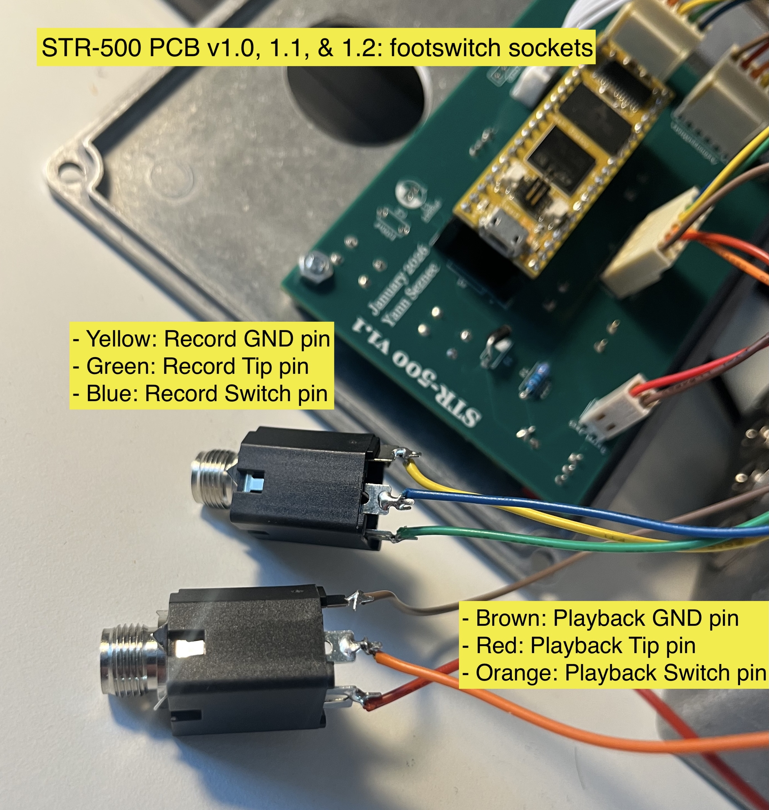
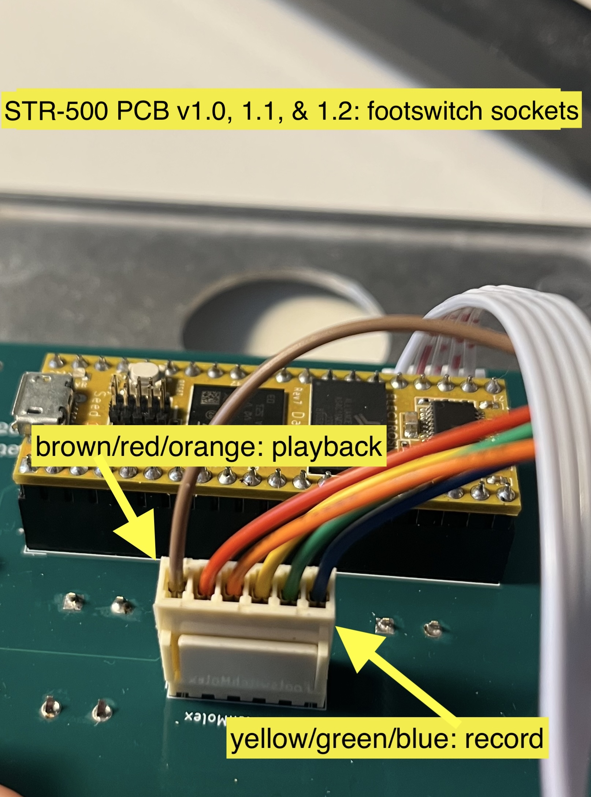

# STR500 Build notes (v1.2)

## Gametrak
For my builds of the STR-500 I use a second generation Gametrak, which is easiest to disassemble and reassemble into a new container. See this video for info on how to hack: https://youtu.be/JUrJCBs35Bo 

When you disassemble a second generation Gametrak you will get two string cartridges. Each cartridge has wires connected to the string and joystick with a 5 pin JST PH (2mm spacing) connector. On the PCB you have two choices:
1. use an identical JST PH connector to the one on the Gametrak, and connect the gametrak to the PCB using a socket-to-socket five pin JST PH cable (you can buy these premade or crimp them yourself)
2. solder some 2.54mm pins to the PCB and connect the gametrak to those somehow, either soldering the wires to the PCB or crimping 2.54mm pins onto the Gametrak wires. When you hack out a second generation Gametrak the wires are color-coded, and the order needs to be preserved to work on the PCB. These are:
- Green: Power
- Yellow: Joystick X (or Y? it's sometimes difficult to guess)
- Orange: string pull distance
- Red: Joystick Y (or X...)
- Brown: Ground

You can also connect any potentiometers or analog inputs to these pins! You'll just need to figure out how to connect all three to the single power pin and single ground pin. The v2.1 version of the PCB has extra 2.54mm pin sockets for anyone who wants to connect normal potentiometers more easily or if you want to hack an earlier model Gametrak. The first version Gametrack did not have unified power and ground pins, and the string is not as usefully self-contained. 
To-do: make a guide for connecting any analog inputs to these pins.

## Wiring the Molex connectors
For ease of build I used pre-wired 6-way Molex connectors for the footswitch controls. I also use pre-wired 2-way connectors for Power and Audio input/output. These attach to standard molex pins on the PCB. They use standard 2.54mm hole distances, so other methods are possible.

## Note! Possibly confusing Molex footprint!
The PCB version 1.2 (labeled October 2026) has a possibly confusing screenprint illustration for the audio input and output pins. The outline implies that the Molex should be mounted with the back support facing the board. If you buy the pre-crimped 2-pin cables that are linked on the BOM, and you want to color code the brown cables to ground, you should actually mount the Molex pins in the opposite direction. This will ensure that the red wires are carrying signal and the brown wires are carrying ground. The "-" symbol on the board is indicating the correct pin for ground. 

You can approach the wiring of those holes in many ways, so this may not apply to you at all. Just be sure that the pins labeled "-" are connected to the ground pin on your audio sockets. 

Here are some completed STR-500 PCBs (without Seed microcontrollers) for reference. These pictures show the August 2026 version, which is nearly identical to the October 2026 version.

## Audio Inputs and Outputs (these are identical)
The audio input and output are both split into left and right, and each input and output channel have an accompanying ground. In the STR-500 code there is no switching between mono and stereo, it is always running both channels simultaneously. That means if you want to just stay in mono you could just use the Left (or Right) input an use the Left (or Right) input.

I, however, personally prefer to have the input and output channels switchable between mono and stereo. To achieve this in the simplest and most flexible way possible, I do the switching using switchable jacks such as the ones listed in the BOM. 

For each channel, input and output, the sockets have their signal (tip) pins connected to the signal pin on the PCB, and their grounds connected to the ground pin (labeled "-" on the board). The switching pin for sockets for the Right channels (input and output) are connected to the signal pins on the Left channel. Thus, when nothing is plugged into the Right channel, the signal going to (or from) the Right channel is routed directly to the Left channel.

I recognize there are some issues with doing it this way, but I have found it works for me! However, suggestions for improvements on this would be most welcome. 

## Footswitch pins

The footswitches work by interrupting the path between the PCB-mounted buttons and the microcontroller. The signal is passed through the switching sockets and then into the Seed. This means that the code on the Seed can use a single digital input for either the buttons or the footswitches. It also means that the Play and Record buttons on the lid are bypassed when a footswitch is plugged into their respective sockets. I like it this way!

The main downside is that it means that if nothing is connected to the Footswitch molex header, or indeed if the header is not soldered on at all, the Play and Record buttons **will not work at all**. In order for the buttons to work, you need one of two things:
1. *Either* the switching footswitch sockets are wired up and the molex header is connected to the board. This is detailed below. 

2. *Or* the pins on the PCB are bridged, by soldering or wires, or (most simply) using the jumper caps listed on the BOM. The pins to connect are indicated on the PCB, and this picture shows them in place:

### Making the Footswitch connector
Here is how I wire up the 6-pin footswitch connector using the precrimped Molex cables I link to on the BOM:

- Brown: Playback GND pin
- Red: Playback Tip pin
- Orange: Playback Switch pin
- Yellow: Record GND pin
- Green: Record Tip pin
- Blue: Record Switch pin

Be sure to mount the molex socket in the correct orientation to ensure that the color coding makes sense.

## Capacitors
These are kind of optional, they should theoretically lessen the noise on the audio output. Different values may give you different results, and the audio will work perfectly fine without them (albeit with some noise). 

## Buttons
I use nice MEC buttons for the bigger buttons. The smaller buttons are generic 6x6x13 tactile buttons, you can probably find different ones from the ones on the BOM. 

## Daisy Seed & Pure Data
See the STR500_code folder for the code and some information on how to load it onto the Seed.

## Check the KiCAD
This repo also has the KiCAD project included so you can check the circuit and layout if you aren't sure (and if you know how to use KiCAD!). 

