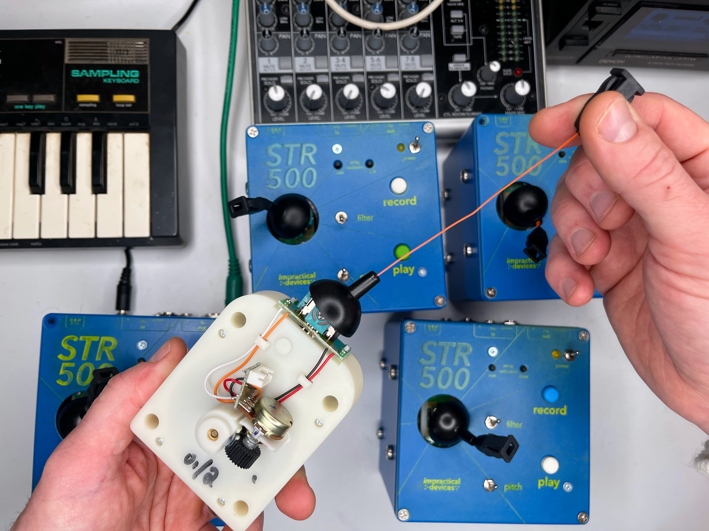
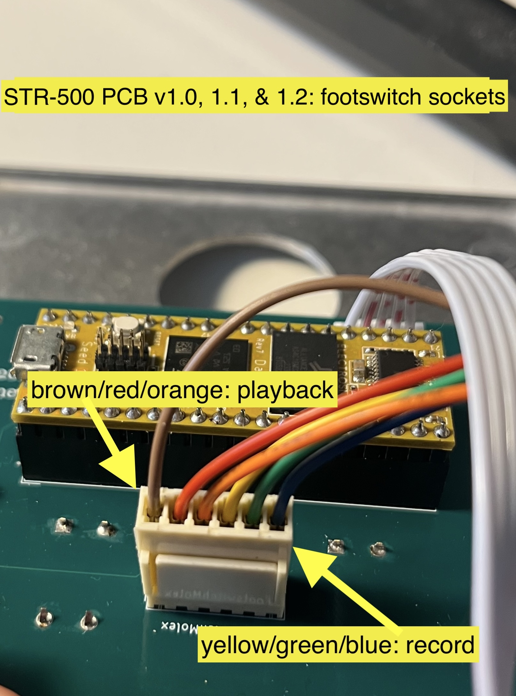

### STR500 Build notes (v1.2)

# Gametrak
For my builds of the STR-500 I use a second generation Gametrak, which is easiest to disassemble and reassemble into a new container. See this video for info on how to hack: https://youtu.be/JUrJCBs35Bo 

When you disassemble a second generation Gametrak you will get two string cartridges. Each cartridge has wires connected to the string and joystick with a 5 pin JST connector. On the PCB you have two choices:
1. use an identical JST connector to the one on the Gametrak, and connect the gametrak to the PCB using a socket-to-socket five pin JST cable (you can buy these premade or crimp them yourself)
2. solder some 2.54" pins to the PCB and connect the gametrak to those somehow, either soldering the wires to the PCB or crimping 2.54" pins onto the Gametrak wires. When you hack out a second generation Gametrak the wires are color-coded, and the order needs to be preserved to work on the PCB. These are:
- Green: Power
- Yellow: Joystick X (or Y? it's sometimes difficult to guess)
- Orange: string pull distance
- Red: Joystick Y (or X...)
- Brown: Ground

You can also connect any potentiometers or analog inputs to these pins! You'll just need to figure out how to connect all three to the single power pin and single ground pin. The v2.1 version of the PCB has extra 2.54" pin sockets for anyone who wants to connect normal potentiometers more easily or if you want to hack an earlier model Gametrak. The first version Gametrack did not have unified power and ground pins, and the string is not as usefully self-contained. 
To-do: make a guide for connecting any analog inputs to these pins.

# Wiring the Molex connectors
For ease of build I used pre-wired 6-way Molex connectors for the footswitch controls. I also use pre-wired 2-way connectors for Power and Audio input/output. These attach to standard molex pins on the PCB. They use standard 2.54" hole distances, so other methods are possible.

## Audio Inputs and Outputs (these are identical)
- to do: fill this out and add photos

## Footswitch pins
To-do: add an explanation here for how to bridge the connectors if you're not using footswitch jacks

Footswitch connector, using the precrimped Molex cables I link to on the BOM:

- Brown: Playback GND pin
- Red: Playback Tip pin
- Orange: Playback Switch pin
- Yellow: Record GND pin
- Green: Record Tip pin
- Blue: Record Switch pin

Be sure to mount the molex sockets in the correct orientation to ensure that the color coding makes sense.

# Capacitors
These are kind of optional, they should theoretically lessen the noise on the audio output. Different values may give you different results, and the audio will work perfectly fine without them (albeit with some noise). 

# Buttons
I use nice MEC buttons for the bigger buttons. The smaller buttons are generic 6x6x13 tactile buttons, you can probably find different ones from the ones on the BOM. 

# Daisy Seed & Pure Data
See the STR500_code folder for the code and some information on how to load it onto the Seed.

# Check the KiCAD
This repo also has the KiCAD project included so you can check the circuit and layout if you aren't sure (and if you know how to use KiCAD!). 

