# STR500 PCB component soldering guide (v1.2, October 2026)

# Step by step instructions for soldering the STR500 PCB

[See the BOM here for all of the parts used in this guide](../STR500_1.2_BOM.csv)

You can buy the PCB from here, or make it yourself from the [KiCad project files](../../kicad). 

The order of soldering here is totally optional, this is simply the method that I find most practical, and it might be useful for those of you who are a bit less experienced. Some of the steps here will include a few little tips too. 
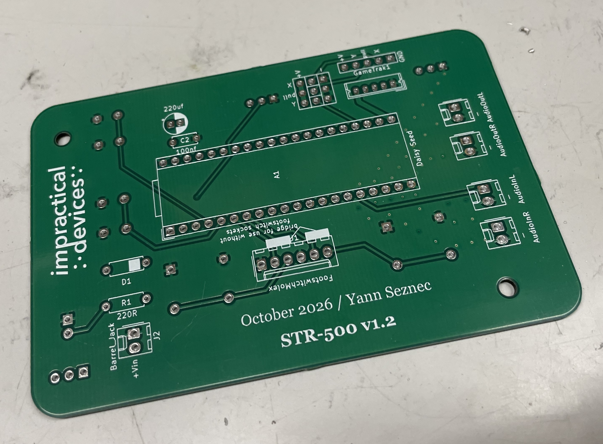

## Step 1: solder the resistor, diode, and small capacitor
I start by soldering all of the components on the *back* side of the board. This is the side with the board name and number on it. 

The resistor is for the LED. I use 220ohm as it works well with the yellow LEDs I usually use, other values are possible, you just need to match your resistor to the LED, assuming a voltage of 3.3v from the microcontroller.

The diode provides basic power protection. Make sure to put this in the correct orientation.

The capacitor is for basic noise filtering. Orientation doesn't matter.

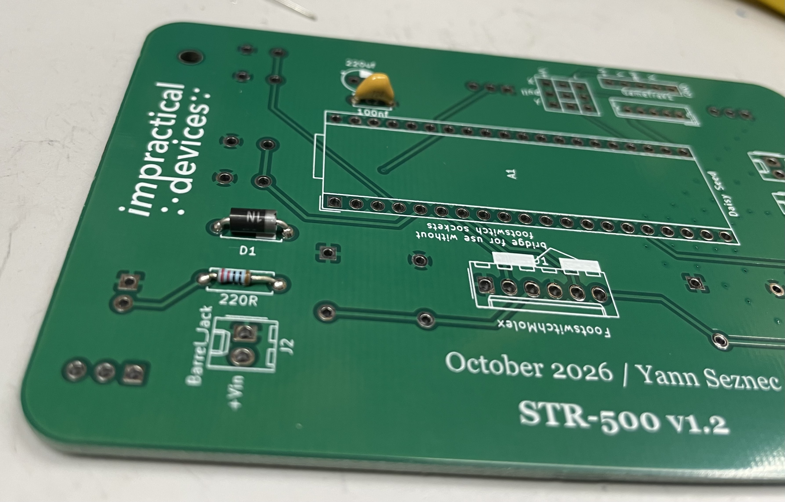

## Step 2: JST PH connector
This is the socket for the Gametrak string, if you use a standard JST PH ribbon cable. This matches the one on the v2 Gametrak string, which I use in my STR-500 builds. If you are using a v1 Gametrak, or some other analog input controls, this socket is likely unnecessary and can be omitted.

This sockets, and indeed the pins in the next steps, can be quite tricky to solder, as they move around or fall out when you turn the board over. My method for this is to use a sheet of packing foam, as you can see in the pictures. I place the components on the PCB, then cover the PCB and loose components with the foam, and hold it all in place while flipping them over. With some light pressure to keep everything together I solder one pin on each component, then check the alignment. I adjust as necessary and then finish the rest of the soldering. 

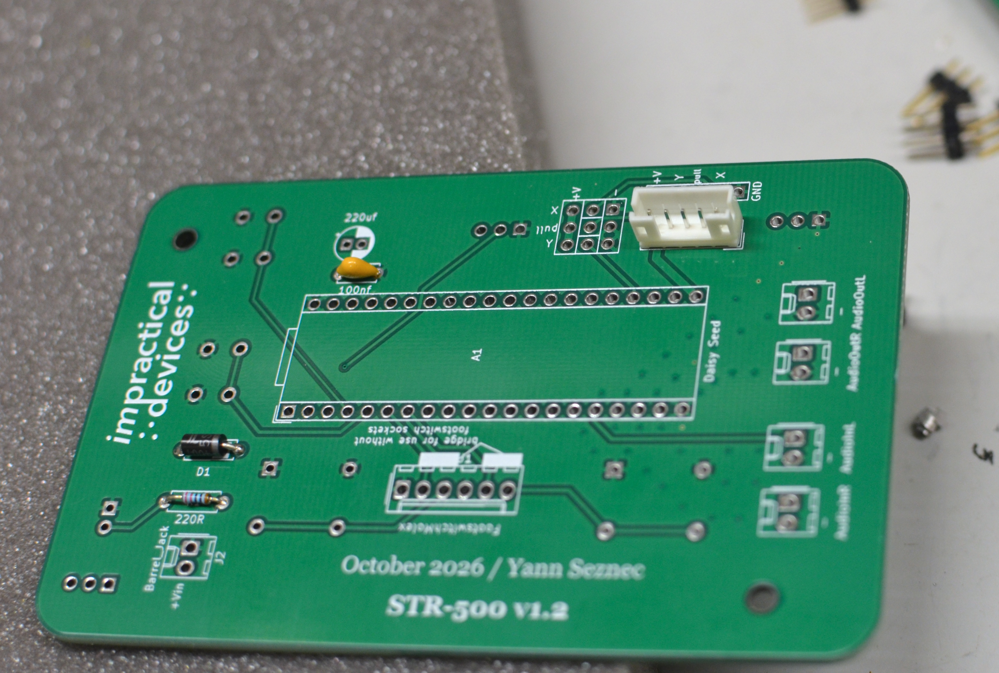

## Step 3: 2.54mm pin breakouts
Solder the 2.54mm header pins into place. These are also optional, depending on what method you are using to connect your string (or other analog inputs). If you are using the v2 Gametrak, these may be unnecessary as you only really need the JST PH connector. These pins are mainly useful for connecting a v1 Gametrak string, or other potentiometers or sensors.

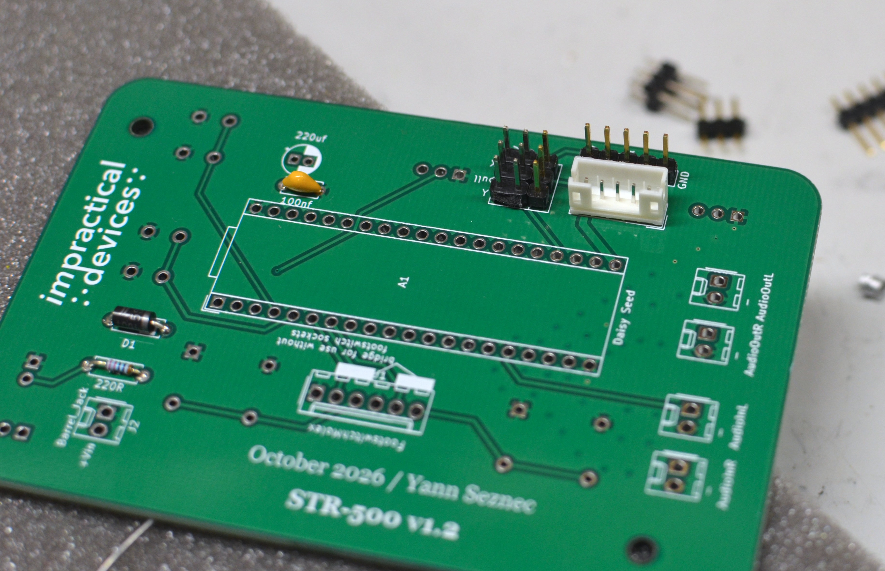

## Step 4: Molex connectors
For ease of build I use Molex connectors for the footswitch controls, Power, Audio input/output. They use standard 2.54mm hole distances, so other methods are possible. I find the Molex system to be very useful in terms of being able to mount the connectors and Gametrak separately in the box while retaining stability once they are plugged in. You can substitute any other 2.54mm pin type here, or even just solder your wires directly to the board if you're feeling confident. 

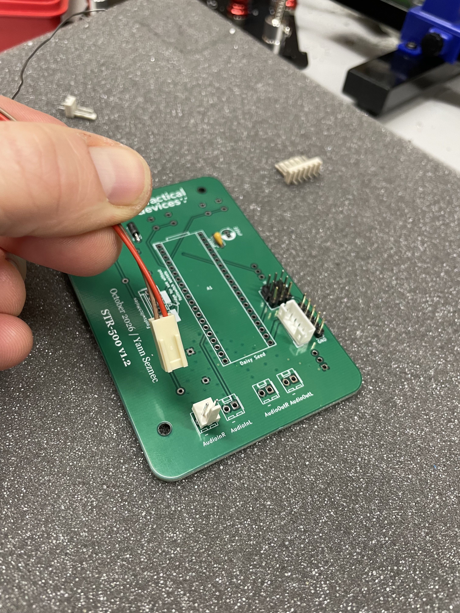

I usually use pre-crimped Molex wires, because I'm lazy. If you are lazy like me, but still want your color coding to make some sense, be sure to check the polarity of the sockets. For the audio sockets, the ground side is labeled "-" on the PCB, which I usually code as brown. For the power socket, the voltage side is labeled "+Vin". Make sure your Molex sockets match the direction that you want your wires to be - the screenprint on the PCB might not match this.

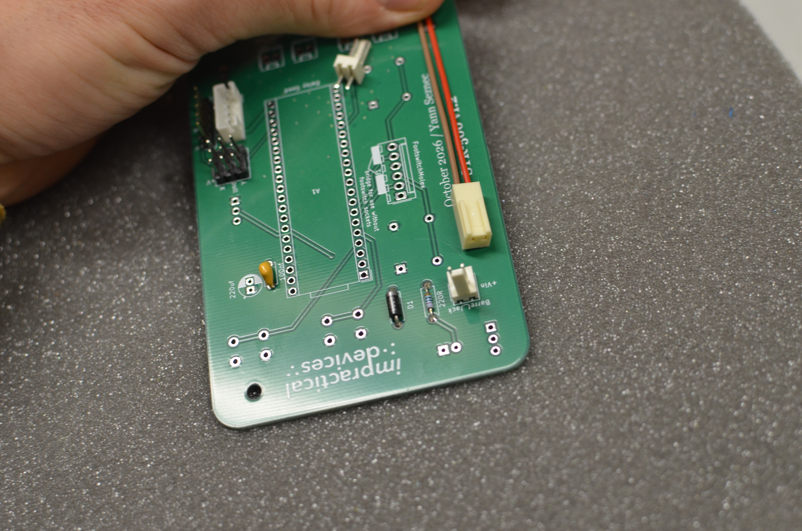

Solder the footswitch socket as well. See the [build notes](../Build_Notes.md) for details on how this works, and how to bypass them if you never intend on using footswitches. 

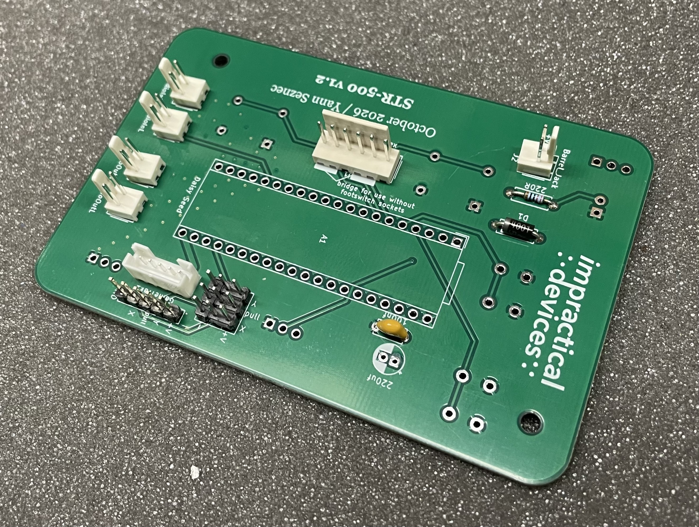

## Step 5: the Daisy Seed sockets

Take your Daisy Seed board and attach the two sockets. Then sit the board + sockets onto the PCB - this ensures that the sockets will be correctly aligned. 
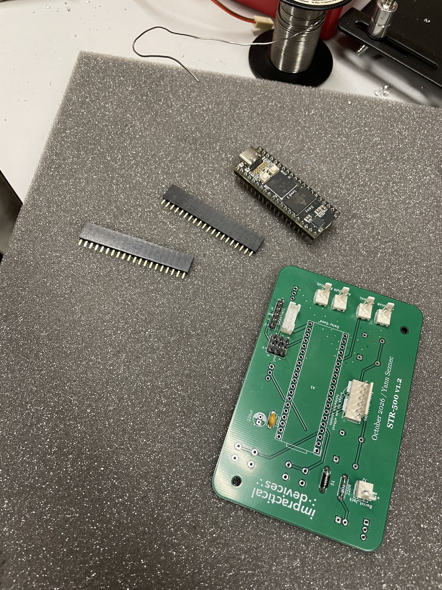
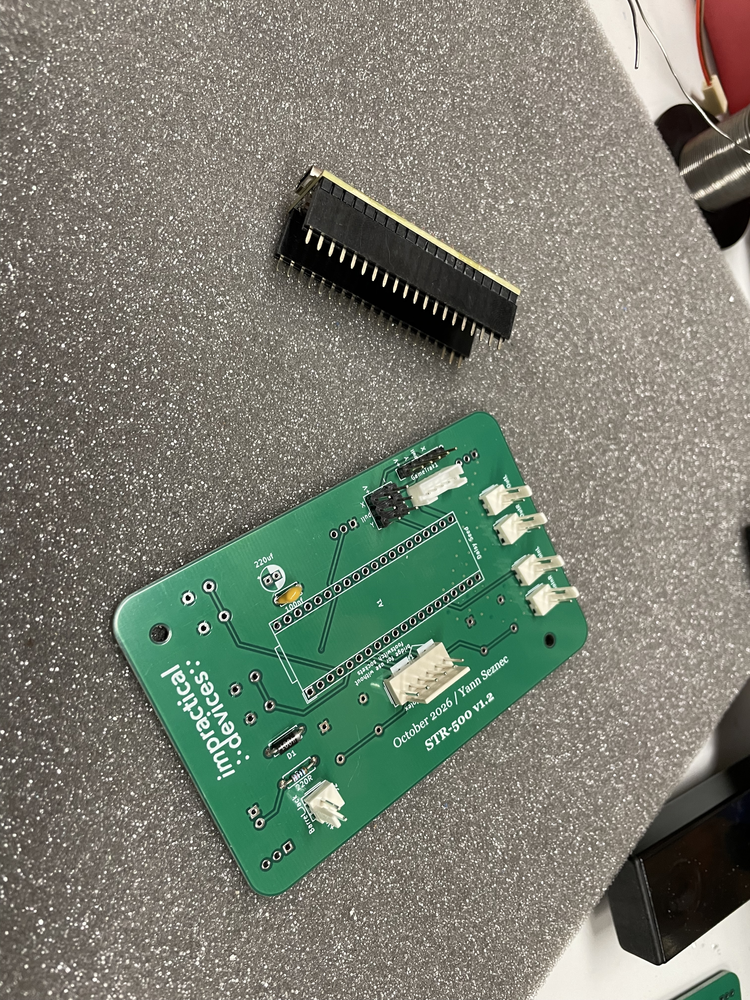
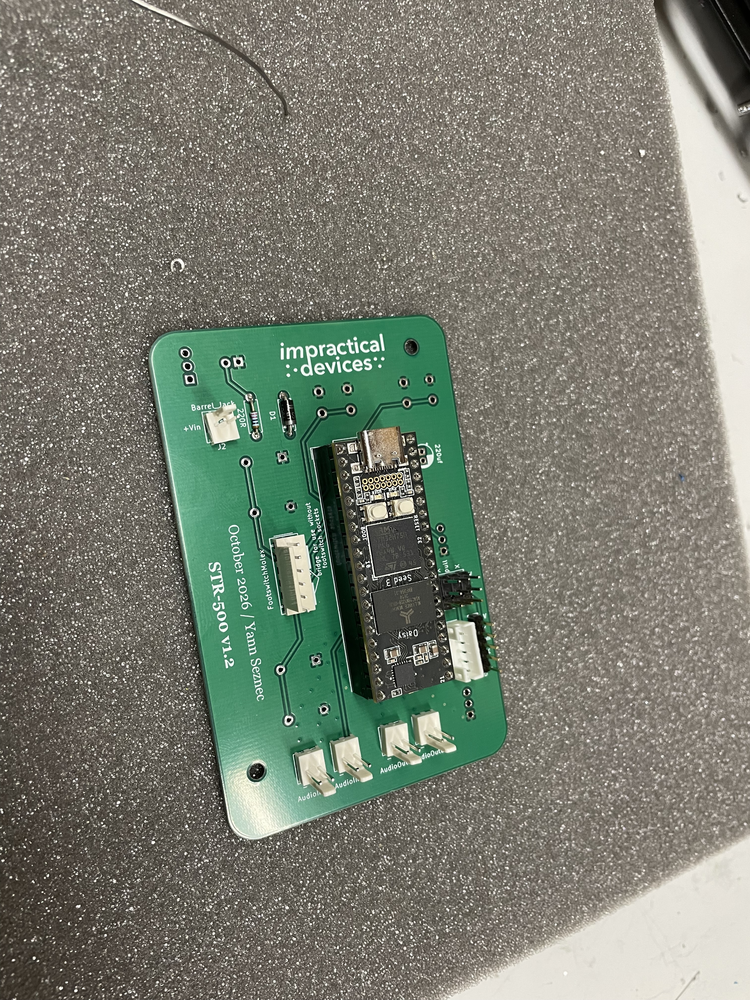

Solder the pins from the back, and then remove the Seed so that you don't accidently burn it with your soldering iron when you attach the components on the other side. 
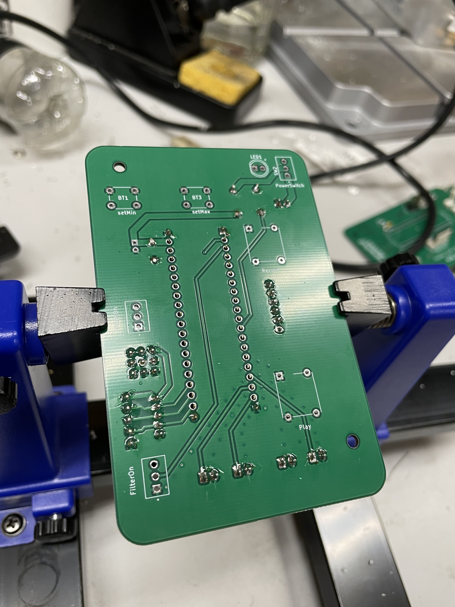
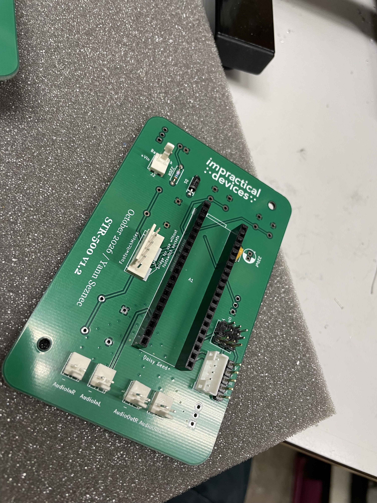

## Step 6: the electrolytic capacitor
The last step on this side of the board is the solder the bigger capacitor. I do this last because because (depending on the exact model capacitor) it is usually the tallest component on the board.

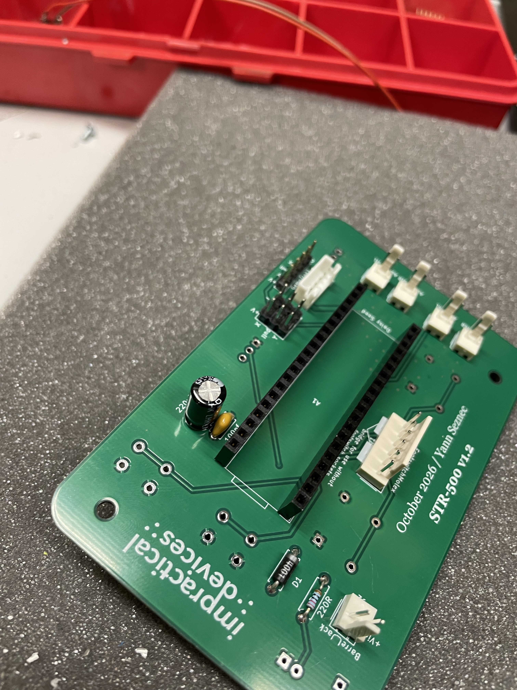

## Step 7: the bigger buttons

Turn the board over, and start to attach the interface components. Start with the bigger buttons - solder this *without* the button caps, as these are easily melted by a careless movement of the soldering iron. 

These buttons, and the ones in the next step, tend to stay in place nicely while soldering.

## Step 8: the smaller buttons

Move onto the small buttons and solder them in.

## Step 9: the switches

The switches can be fiddly and tricky to align correctly. My own method is to use the lid from a pre-drilled STR-500 enclosure. I sit the switches in the PCB, then place the lid over the buttons so they pop out through their respective holes. I hold these together, flip it over, and then solder them in place. This way they are guaranteed to be aligned correctly. 

This method only works if you have a pre-drilled lid, of course! If you don't, you'll need to figure out your own method. Good luck!

## Step 10: the LED

The LED sits next to the power switch. I usually just place this by eye, getting the height so that the ridge of the LED is just below the body of the switch. Be sure that the long leg of the LED is in the hole labeled "+". 

(I know I should use a little spacer or something, I keep forgetting to find these)

## Step 11: last bits

Attach your button caps on your big buttons. Screw in the standoffs on the board (these are optional but I find them very useful). The PCB is now done!

# How I wire my STR-500 instruments

If you are making the PCB yourself you may want to figure out your own connectors! The molex/2.54mm pin system on the board means there are many options. The following steps detail my own approach to this, which may or may not be useful for you.

## Step 12: Power socket

Wire up your power socket to the molex connector.

## Step 13: Audio sockets

I use switching audio sockets, to enable simple mono/stereo switching. See the [build notes](../Build_Notes.md) for more info on this. 

First I solder up the four audio sockets identicallly.

Then I connect two pairs together, with a wire going from the switch pin on one socket to the signal pin on another.

The sockets that I have soldered wires onto the switch pins are the Right channel (input and output). 

## Step 14: Footswitch sockets

Here is the wiring for the footswitch socket, using the pre-crimped six-pin molex wires linked in the BOM. See the [build notes](../Build_Notes.md) for more details on this.

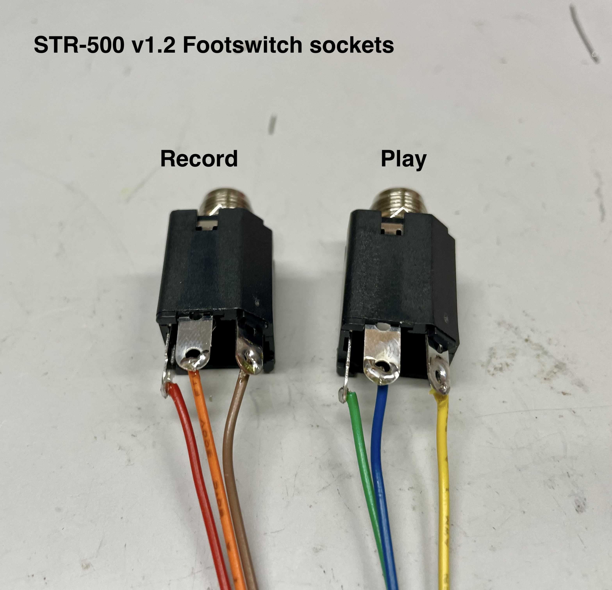

# All done

Your PCB should be ready to go. You'll need to flash the Daisy Seed with the STR-500 code, if you haven't already.

Be sure to read through the [build notes](../Build_Notes.md) for some extra details, particularly regarding the Gametrak connection options and the footswitch connectors.
